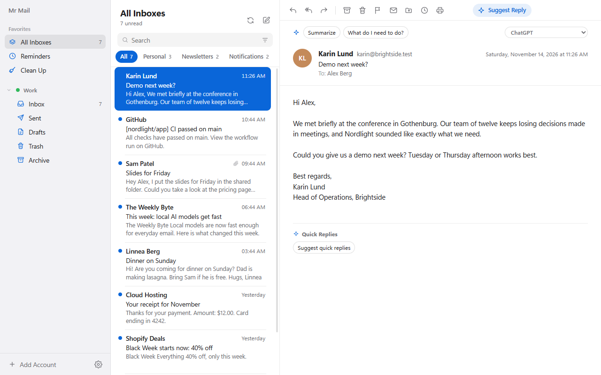

<p align="center">
  
</p>

<h1 align="center">Mr Mail</h1>

<p align="center">
  <b>A fast, private email client for Windows that your AI agents can drive.</b><br>
  Clean like Apple Mail. Local first. Claude Code, Zed and any MCP client can read, sort and draft your email.
</p>

<p align="center">
  <a href="https://github.com/GKihlstadius/mr-mail/releases/latest"></a>
  <a href="https://github.com/GKihlstadius/mr-mail/actions/workflows/ci.yml"></a>
  <a href="LICENSE"></a>
  
  
</p>

<p align="center">
  
</p>

## Why

Most email clients are either heavy, ad funded, or route your mail through someone else's servers. Mr Mail talks IMAP and SMTP straight to your provider, keeps everything on your computer, and gives AI agents a safe, well defined way to help with your inbox.

- **Your mail stays yours.** No account, no cloud sync, no tracking. Passwords and tokens are encrypted with Windows (safeStorage). Remote images are blocked until you allow them.
- **Built for AI agents.** 22 MCP tools: search, read, summarize, draft, edit drafts, attach files, read attachments (Word, Excel, PowerPoint, text), schedule, clean up. Nothing is sent unless you ask for it; drafts open in the app for you to review.
- **Fast.** IMAP IDLE for instant new mail, a local SQLite cache, and a list that stays smooth with tens of thousands of emails.

## Features

| | |
|---|---|
| **Smart inbox** | Tabs for Personal, Newsletters and Notifications. People you have written to always land in Personal. |
| **Clean Up** | See who sends you the most, unsubscribe in one click (RFC 8058), archive or delete everything from a sender, set rules for the future. |
| **Undo everything** | Undo send, undo archive and delete (Ctrl+Z), multi select with Ctrl and Shift. |
| **Send later and Remind me** | Schedule emails, snooze messages, follow up if nobody replies. |
| **Notifications that do things** | Archive, mark as read or reply straight from the Windows notification. |
| **Templates and signatures** | Rich text signatures per account, reusable templates, import signatures from Spark. |
| **AI in the app (optional)** | Suggested replies, summaries and to-dos with ChatGPT, Claude, a local model or your own OpenAI compatible server. AI only ever writes drafts. |
| **Accounts** | Gmail, Outlook and Microsoft 365, iCloud, and any IMAP server. Sign in with Google or Microsoft (bring your own client id) or use an app password. |
| **Languages** | English and Swedish, following Windows or your choice. |
| **Light and dark** | Follows Windows, or pick one. |

<p align="center">
  
  
</p>

## Install

1. Download `MrMail-Setup-x.y.z.exe` from the [latest release](https://github.com/GKihlstadius/mr-mail/releases/latest).
2. Run it. The installer is not code signed yet, so Windows SmartScreen may say it "protected your PC": click **More info**, then **Run anyway**.
3. Add your account. Mr Mail finds the server settings for most providers automatically.

Mr Mail updates itself: when a new release is published, the app offers **Install and restart**. The only thing the app sends anywhere besides your own mail servers is that version check against the GitHub API.

## Let your AI agent handle email

Mr Mail ships an MCP server. With the app installed:

**Claude Code**

```
claude mcp add mr-mail --scope user -e ELECTRON_RUN_AS_NODE=1 -- "%LOCALAPPDATA%\Programs\mr-mail\MrMail.exe" "%LOCALAPPDATA%\Programs\mr-mail\resources\mr-mail-mcp.cjs"
```

**Zed** (`settings.json`)

```json
"context_servers": {
  "mr-mail": {
    "source": "custom",
    "command": "C:\\Users\\<you>\\AppData\\Local\\Programs\\mr-mail\\MrMail.exe",
    "args": ["C:\\Users\\<you>\\AppData\\Local\\Programs\\mr-mail\\resources\\mr-mail-mcp.cjs"],
    "env": { "ELECTRON_RUN_AS_NODE": "1" }
  }
}
```

Settings, **Control with AI tools**, shows the exact lines for your computer. Then just ask:

> "Summarize what came in today and draft a reply to Karin saying Tuesday at 2 works."
> "Save the attachment from Sam to Downloads, then reply to all with the edited image attached."
> "Unsubscribe me from every newsletter I have not opened in three months."

The rules the agent gets: never send unless you explicitly asked, otherwise save a draft and open it in the app; never delete unless asked. New tools show up in your agent automatically after an app update. Full tool list: [docs/mcp.md](docs/mcp.md).

## Build from source

Requires Node 24 or newer, pnpm 10 and Windows.

```
pnpm install
pnpm start        # build and run
pnpm typecheck    # TypeScript and translation check
pnpm test         # unit tests (IMAP tests run when GreenMail is up)
pnpm dist         # installer in release/
```

Integration and end to end tests run against [GreenMail](https://greenmail-mail-test.github.io/greenmail/) in Docker, never against real accounts:

```
docker run -d --name mr-mail-greenmail --cpus 1 -p 3025:3025 -p 3143:3143 -e GREENMAIL_OPTS="-Dgreenmail.setup.test.all -Dgreenmail.hostname=0.0.0.0 -Dgreenmail.auth.disabled" greenmail/standalone:2.1.5
pnpm build && pnpm test:e2e
```

Stack: Electron, React, TypeScript, imapflow, nodemailer, mailparser, node:sqlite, DOMPurify. No UI framework, about 13 000 lines.

Sign in with Google or Microsoft needs your own OAuth client id (free, about ten minutes): see [docs/oauth.md](docs/oauth.md). App passwords work without it.

## Support the project

Mr Mail is free and MIT licensed. If it saves you time, you can buy me a coffee:

- **Crypto (BNB Smart Chain, Ethereum or any EVM chain):** `0x9869799157186227bA3Cc980bAE3C64E022453a0`

Stars, bug reports and pull requests help just as much.

## På svenska

Mr Mail är en snabb och privat mejlklient för Windows, på svenska och engelska. Den pratar direkt med din mejlserver, sparar allt på datorn och låter AI-verktyg som Claude Code läsa, sortera och skriva utkast åt dig. Ladda ned den senaste versionen under [Releases](https://github.com/GKihlstadius/mr-mail/releases/latest).

## License

[MIT](LICENSE)
