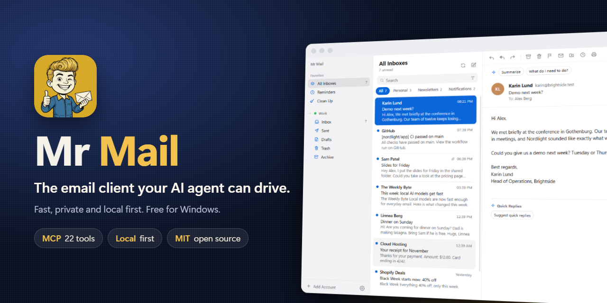
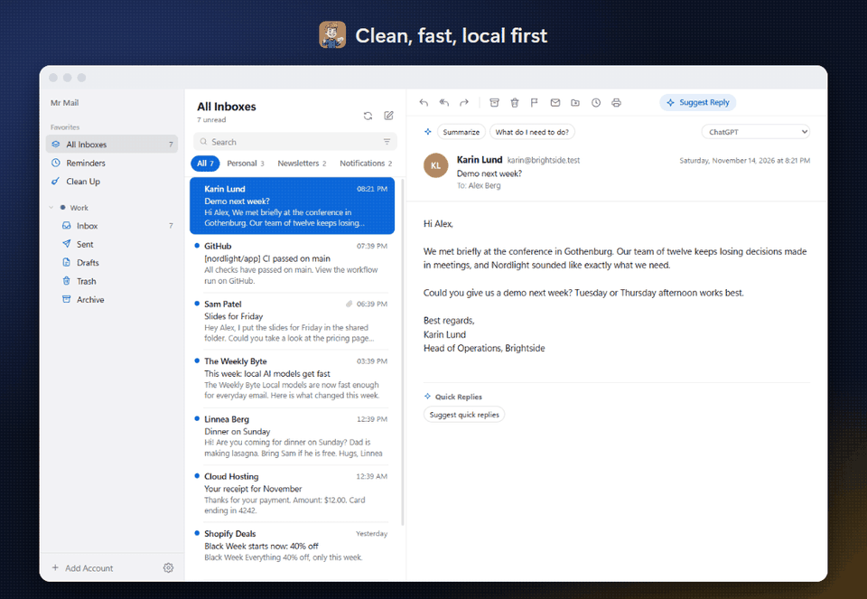
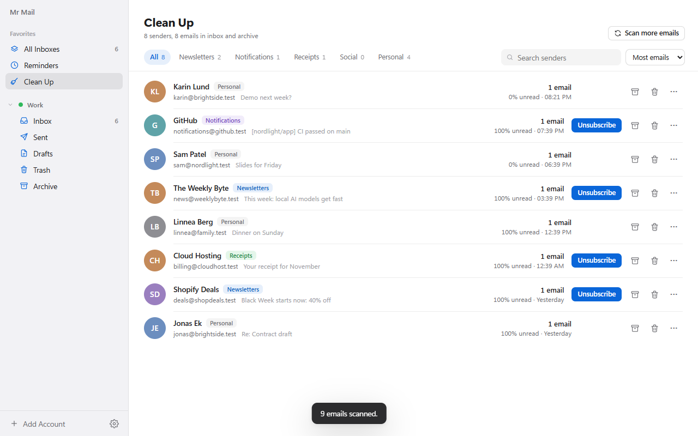
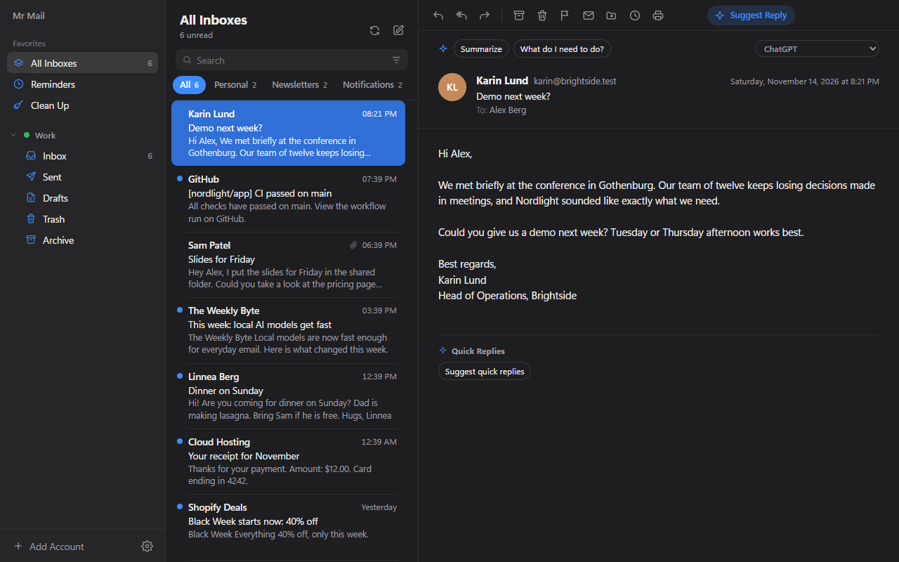

<div align="center">



<br>

<a href="https://github.com/GKihlstadius/mr-mail/releases/latest"></a>
<a href="https://github.com/GKihlstadius/mr-mail/stargazers"></a>
<a href="https://github.com/GKihlstadius/mr-mail/releases"></a>

<a href="https://github.com/GKihlstadius/mr-mail/actions/workflows/ci.yml"></a>
<a href="LICENSE"></a>

<a href="docs/mcp.md"></a>


### A fast, private email client for Windows that Claude Code, Zed and any MCP agent can drive.

**[Download](https://github.com/GKihlstadius/mr-mail/releases/latest)** &nbsp;·&nbsp; **[Features](#features)** &nbsp;·&nbsp; **[AI agents](#let-your-ai-agent-handle-email)** &nbsp;·&nbsp; **[FAQ](#faq)** &nbsp;·&nbsp; **[Contribute](CONTRIBUTING.md)**

<br>



</div>

<br>

## Why Mr Mail

<table>
<tr>
<td width="33%" valign="top">

### Your mail stays yours
No account, no cloud sync, no tracking. Mr Mail talks IMAP and SMTP straight to your provider and keeps everything on your computer. Passwords are encrypted by Windows, remote images are blocked until you allow them.

</td>
<td width="33%" valign="top">

### Built for AI agents
A built in MCP server with 22 tools. Your agent can search, read, summarize, draft, attach files, read Word and Excel attachments, schedule and clean up. It never sends unless you ask.

</td>
<td width="33%" valign="top">

### Fast and calm
IMAP IDLE for instant mail, a local SQLite cache and a list that stays smooth with tens of thousands of emails. A clean design in the spirit of Apple Mail, in light and dark.

</td>
</tr>
</table>

## Let your AI agent handle email


Install Mr Mail, then connect your agent with one line.

**Claude Code**

```
claude mcp add mr-mail --scope user -e ELECTRON_RUN_AS_NODE=1 -- "%LOCALAPPDATA%\Programs\mr-mail\MrMail.exe" "%LOCALAPPDATA%\Programs\mr-mail\resources\mr-mail-mcp.cjs"
```

<details>
<summary><b>Zed</b> (settings.json)</summary>

```json
"context_servers": {
  "mr-mail": {
    "source": "custom",
    "command": "C:\\Users\\<you>\\AppData\\Local\\Programs\\mr-mail\\MrMail.exe",
    "args": ["C:\\Users\\<you>\\AppData\\Local\\Programs\\mr-mail\\resources\\mr-mail-mcp.cjs"],
    "env": { "ELECTRON_RUN_AS_NODE": "1" }
  }
}
```

</details>

<details>
<summary><b>Any other MCP client</b></summary>

Run `MrMail.exe` with the environment variable `ELECTRON_RUN_AS_NODE=1` and the path to `resources\mr-mail-mcp.cjs` as its only argument. It speaks MCP over stdio. **Settings, Control with AI tools** in the app shows the exact lines for your computer.

</details>

Then just ask:

> *"Summarize what came in today and draft a reply to Karin saying Tuesday at 2 works."*<br>
> *"Save the attachment from Sam to Downloads, then reply to all with the edited image attached."*<br>
> *"Unsubscribe me from every newsletter I have not opened in three months."*

**Safe by design.** Agents never send unless you explicitly asked; otherwise they save a draft that opens in the app for you to review. They never delete unless asked. New tools show up in your agent automatically after an app update. Full tool list: [docs/mcp.md](docs/mcp.md).

## Features

| | |
|---|---|
| **Smart inbox** | Tabs for Personal, Newsletters and Notifications. People you have written to always land in Personal. |
| **Clean Up** | See who sends you the most, unsubscribe in one click (RFC 8058), archive or delete everything from a sender, set rules for the future. |
| **Undo everything** | Undo send, undo archive and delete (Ctrl+Z), multi select with Ctrl and Shift. |
| **Send later and Remind me** | Schedule emails, snooze messages, get reminded if nobody replies. |
| **Notifications that do things** | Archive, mark as read or reply straight from the Windows notification. |
| **Templates and signatures** | Rich text signatures per account, reusable templates, import signatures from Spark. |
| **AI in the app** *(optional)* | Suggested replies, summaries and to dos with ChatGPT, Claude, a local model or your own OpenAI compatible server. AI in the app only ever writes drafts. |
| **Accounts** | Gmail, Outlook and Microsoft 365, iCloud and any IMAP server. Sign in with Google or Microsoft, or use an app password. |
| **Languages** | English and Swedish, following Windows or your choice. |
| **Auto update** | New releases install with one click from inside the app. |

<p align="center">
  
  
</p>

## How it compares

| | **Mr Mail** | Thunderbird | New Outlook | Spark |
|---|:---:|:---:|:---:|:---:|
| Free | ✓ | ✓ | ✓ | Freemium |
| Open source | ✓ | ✓ | | |
| Mail goes only between you and your provider | ✓ | ✓ | | |
| Built in MCP server for AI agents | ✓ | | | |
| Smart inbox that puts people first | ✓ | | ✓ | ✓ |

New Outlook syncs non Microsoft accounts through Microsoft's cloud, and Spark stores account access on its own servers to deliver push and team features.

## Install

1. Download `MrMail-Setup-x.y.z.exe` from the [latest release](https://github.com/GKihlstadius/mr-mail/releases/latest).
2. Run it. The installer is not code signed yet, so Windows SmartScreen may say it *protected your PC*: click **More info**, then **Run anyway**.
3. Add your account. Mr Mail finds the server settings for most providers automatically.

Mr Mail updates itself. The only thing it sends anywhere besides your own mail servers is a version check against the GitHub API, plus requests to the AI service you choose, if you turn AI on.

## FAQ

<details>
<summary><b>Does my email pass through any server of yours?</b></summary>

No. There is no Mr Mail server. The app connects directly to your provider over IMAP and SMTP. Your cache lives in a SQLite file under `%APPDATA%`.

</details>

<details>
<summary><b>What does an AI agent see?</b></summary>

Only what it asks for through the MCP tools, while the app is running on your computer. The MCP server talks to the app over localhost with a random token. Nothing is uploaded unless your agent itself sends it to its model.

</details>

<details>
<summary><b>Can an agent send email without asking me?</b></summary>

The agent is told to send only when you explicitly ask. If it is unsure, it saves a draft that opens in the app, and you press Send yourself.

</details>

<details>
<summary><b>Gmail says my password is wrong.</b></summary>

Gmail and Outlook need either an app password or sign in with Google or Microsoft. Sign in needs your own free OAuth client id, see [docs/oauth.md](docs/oauth.md).

</details>

<details>
<summary><b>macOS or Linux?</b></summary>

Not yet. The code is plain Electron and should port well; pull requests are welcome.

</details>

## Build from source

Requires Node 24 or newer, pnpm 10 and Windows.

```
pnpm install
pnpm start        # build and run
pnpm typecheck    # TypeScript and translation check
pnpm test         # unit tests (IMAP tests run when GreenMail is up)
pnpm dist         # installer in release/
```

Integration and end to end tests run against [GreenMail](https://greenmail-mail-test.github.io/greenmail/) in Docker, never against real accounts:

```
docker run -d --name mr-mail-greenmail --cpus 1 -p 3025:3025 -p 3143:3143 -e GREENMAIL_OPTS="-Dgreenmail.setup.test.all -Dgreenmail.hostname=0.0.0.0 -Dgreenmail.auth.disabled" greenmail/standalone:2.1.5
pnpm build && pnpm test:e2e
```

**Stack:** Electron, React, TypeScript, imapflow, nodemailer, mailparser, node:sqlite, DOMPurify. No UI framework, about 13 000 lines. See [CONTRIBUTING.md](CONTRIBUTING.md) to get started.

## Roadmap

- [x] MCP server with drafts, attachments, scheduling and clean up
- [x] English and Swedish
- [x] Auto update from GitHub Releases
- [ ] Code signed installer
- [ ] Calendar invites (ICS) in the reader
- [ ] More languages (translations are one file per language, see [CONTRIBUTING.md](CONTRIBUTING.md))
- [ ] macOS build

Have an idea? [Open an issue](https://github.com/GKihlstadius/mr-mail/issues/new/choose).

## Support the project

Mr Mail is free and MIT licensed. If it saves you time, you can buy me a coffee:

- **Crypto (BNB Smart Chain, Ethereum or any EVM chain):** `0x9869799157186227bA3Cc980bAE3C64E022453a0`

A star helps more people find it. Bug reports and pull requests help just as much.

<a href="https://star-history.com/#GKihlstadius/mr-mail&Date">
  
</a>

## På svenska

Mr Mail är en snabb och privat mejlklient för Windows, på svenska och engelska. Den pratar direkt med din mejlserver, sparar allt på datorn och låter AI-verktyg som Claude Code läsa, sortera och skriva utkast åt dig. Ladda ned den senaste versionen under [Releases](https://github.com/GKihlstadius/mr-mail/releases/latest).

## License

[MIT](LICENSE). The mascot and icon are original artwork for this project.
